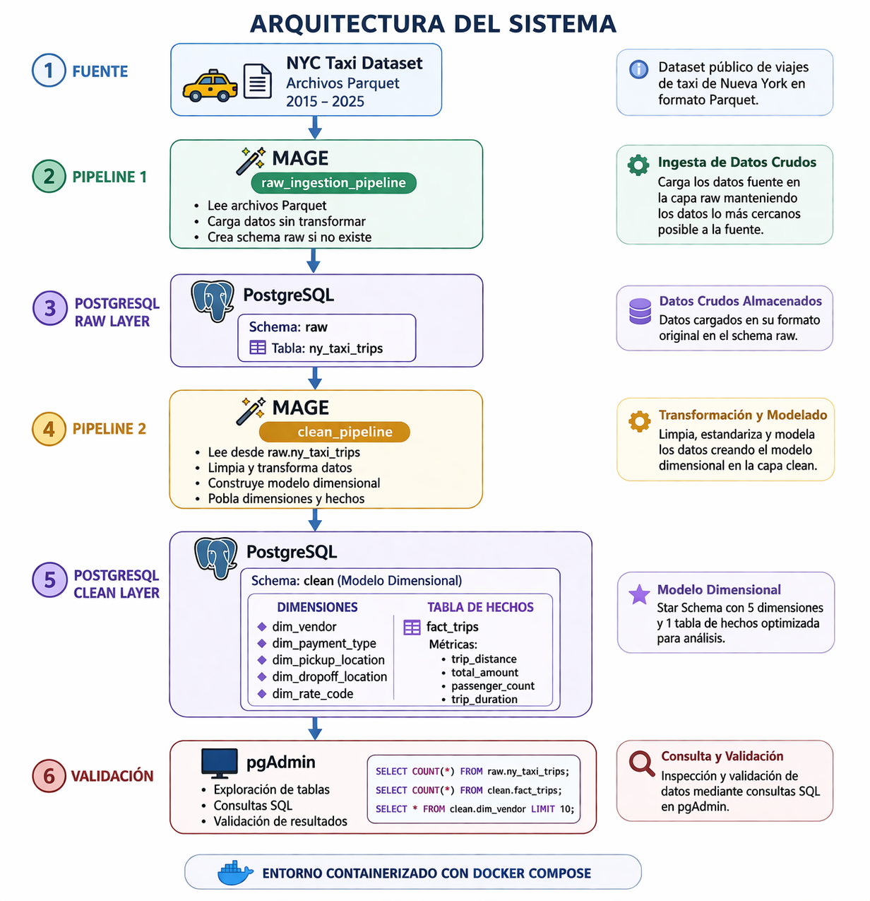

# NYC Taxi ELT Pipeline (2025)

Proyecto desarrollado para la materia **Fundamentos de Ciencia de Datos** de la **Universidad San Francisco de Quito** (Maestría en Ciencia de Datos).

Implementa una arquitectura **ELT** para la ingesta, almacenamiento, transformación y modelado dimensional de los datos históricos de viajes de taxi de Nueva York del año 2025. Todo el entorno se despliega con **Docker Compose**, usa **Mage AI** como orquestador, **PostgreSQL** como data warehouse y **pgAdmin** como herramienta de inspección.

---

## Objetivo

Construir un pipeline de ingeniería de datos reproducible que permita:

* ingerir datos históricos de taxis de Nueva York
* almacenar los datos crudos en una capa **raw**
* transformarlos hacia una capa **clean**
* implementar un **modelo dimensional** (esquema estrella)
* automatizar la ejecución de los pipelines mediante triggers
* validar los resultados mediante consultas SQL en pgAdmin

El proyecto sigue una arquitectura **ELT (Extract-Load-Transform)**: los datos se cargan primero en la capa raw y se transforman después dentro de PostgreSQL hacia la capa clean.

---

## Fuente de datos

Dataset público de viajes de taxi de Nueva York (NYC TLC Trip Record Data).

* Fuente: https://d37ci6vzurychx.cloudfront.net/trip-data/
* Formato: Parquet
* Ejemplo de archivo: `yellow_tripdata_2025-01.parquet`
* Periodo ingerido: año 2025

---

## Arquitectura del sistema



Componentes:

* **NY Taxi Dataset**: fuente de datos (archivos Parquet)
* **Mage AI**: orquestación de pipelines
* **PostgreSQL**: data warehouse (schemas `raw` y `clean`)
* **pgAdmin**: inspección y validación

Flujo de datos:

```
NY Taxi Dataset
(parquet files 2025)
        ↓
 Mage
 raw_ingestion_pipeline
        ↓
 PostgreSQL
 schema: raw
 (raw.ny_taxi_trips)
        ↓
 Mage
 clean_pipeline
        ↓
 PostgreSQL
 schema: clean
 ├ dim_vendor
 ├ dim_payment_type
 ├ dim_pickup_location
 ├ dim_dropoff_location
 └ fact_trips
        ↓
 pgAdmin
 (análisis y validación)
```

---

## Tecnologías utilizadas

* Docker y Docker Compose
* Python y Pandas
* SQL
* Mage AI
* PostgreSQL
* pgAdmin

---

## Estructura del proyecto

```
nyc-taxi-elt-pipeline/
├── docker-compose.yml
├── Dockerfile
├── README.md
├── requirements.txt
├── .env.example
├── notebooks/
│   ├── EDA.ipynb
│   └── ingest-data.py
├── data-orquestador/
│   ├── mage_data/
│   └── orquestador/
└── docs/
    ├── architecture_diagram.png
    ├── modelo_dimensional.docx
    └── evidencias_visuales.docx
```

---

## Cómo ejecutar el proyecto

### 1. Requisitos

* Docker
* Docker Compose

### 2. Configuración

Copia el archivo de ejemplo de variables de entorno y ajusta los valores:

```
cp .env.example .env
```

El archivo `.env` contiene las credenciales de acceso a pgAdmin y PostgreSQL. No se incluye en el repositorio.

### 3. Levantar el entorno

Desde la raíz del proyecto:

```
docker compose up --build
```

Esto inicia los servicios de PostgreSQL, Mage y pgAdmin dentro de la misma red Docker.

### 4. Acceso a los servicios

| Servicio | URL |
|----------|-----|
| Mage | http://localhost:6789 |
| pgAdmin | http://localhost:9000 |

### 5. Ejecutar los pipelines

1. Abre Mage en `http://localhost:6789`.
2. Ejecuta `raw_ingestion_pipeline` (o espera a que lo dispare `trigger_pipeline_raw`).
3. Una vez cargada la capa raw, ejecuta `clean_pipeline`.
4. Valida los resultados en pgAdmin con las consultas de la sección de validación.

---

## Pipelines de datos

El proyecto implementa dos pipelines independientes en Mage.

### 1. Raw Ingestion Pipeline

Nombre: `raw_ingestion_pipeline`

Responsabilidades:

* descargar los datos del dataset NY Taxi
* leer los archivos Parquet
* cargar los datos en PostgreSQL
* crear el schema `raw` si no existe

Tabla resultante: `raw.ny_taxi_trips`

Características:

* reejecución idempotente
* mínima transformación de los datos

### 2. Clean Transformation Pipeline

Nombre: `clean_pipeline`

Responsabilidades:

* leer los datos desde `raw.ny_taxi_trips`
* limpiar datos inconsistentes
* estandarizar columnas
* validar tipos de datos
* construir el modelo dimensional

Resultado: tablas del schema `clean`.

---

## Triggers y automatización

Los pipelines se automatizan con triggers configurados en Mage:

* `trigger_pipeline_raw`: ejecuta la ingesta de datos crudos.
* `Ejecucion Clean Pipeline`: ejecuta el pipeline de transformación una vez cargada la capa raw.

Esto automatiza el flujo completo de datos, de la ingesta al modelo dimensional.

---

## Manejo de secretos

Las credenciales de conexión a PostgreSQL no están escritas en el código. Se utilizan **Mage Secrets**:

```
POSTGRES_DBNAME
POSTGRES_USER
POSTGRES_PASSWORD
POSTGRES_HOST
POSTGRES_PORT
POSTGRES_CONNECT_TIMEOUT
```

Ejemplo de configuración en Mage:

```
POSTGRES_DBNAME: {{ mage_secret_var('pg_db') }}
POSTGRES_USER: {{ mage_secret_var('pg_user') }}
POSTGRES_PASSWORD: {{ mage_secret_var('pg_password') }}
POSTGRES_HOST: {{ mage_secret_var('pg_host') }}
POSTGRES_PORT: {{ mage_secret_var('pg_port') }}
```

---

## Modelo dimensional

La capa `clean` implementa un esquema estrella (Star Schema).

### Tabla de hechos: `fact_trips`

Granularidad: un registro representa **un viaje individual de taxi**.

Métricas:

* `trip_distance`
* `fare`
* `tip`
* `tolls`
* `total_amount`
* `trip_duration`

### Dimensiones

* `dim_vendor`: proveedor del servicio de taxi
* `dim_payment_type`: tipo de pago utilizado
* `dim_pickup_location`: ubicación de inicio del viaje
* `dim_dropoff_location`: ubicación de fin del viaje

### Relaciones

```
fact_trips
│
├── vendor_key           → dim_vendor
├── payment_type_key     → dim_payment_type
├── pickup_location_key  → dim_pickup_location
└── dropoff_location_key → dim_dropoff_location
```

El detalle del diseño está en `docs/modelo_dimensional.docx`.

---

## Validaciones aplicadas en la capa clean

* manejo de valores nulos
* estandarización de nombres de columnas
* tipificación de fechas y valores numéricos
* eliminación de registros inválidos
* validación de coherencia entre pickup y dropoff
* filtrado de distancias o montos negativos

---

## Validación de resultados en PostgreSQL

Consultas de ejemplo para ejecutar en pgAdmin:

```sql
-- Contar registros en la capa raw
SELECT COUNT(*) FROM raw.ny_taxi_trips;

-- Ver datos de la tabla de hechos
SELECT * FROM clean.fact_trips LIMIT 10;

-- Consultar una dimensión
SELECT * FROM clean.dim_vendor;
```

---

## Evidencia visual

El archivo `docs/evidencias_visuales.docx` incluye capturas de:

* contenedores corriendo en Docker
* pipelines visibles en Mage
* triggers configurados
* tablas en los schemas `raw` y `clean`
* consultas ejecutadas en pgAdmin

---

## Conclusión

Este proyecto demuestra la construcción de una arquitectura moderna de ingeniería de datos con herramientas open source, aplicando buenas prácticas como:

* separación entre capas raw y clean
* pipelines independientes y automatizados con triggers
* modelo dimensional en esquema estrella
* orquestación con Mage AI
* manejo seguro de credenciales
* entorno reproducible con Docker Compose

---

## Autor

**Steeven Quezada**
Maestría en Ciencia de Datos, Universidad San Francisco de Quito (USFQ)
GitHub: [github.com/Ste3veN3](https://github.com/Ste3veN3)
